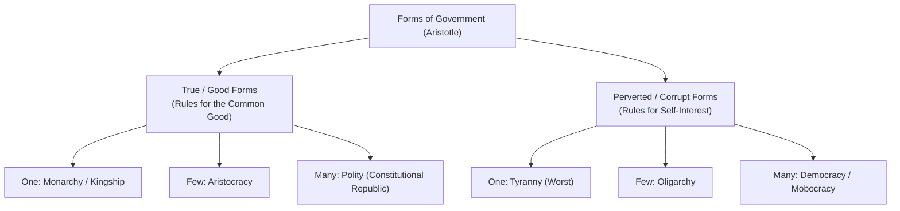

# CLASSICAL NATURAL LAW THEORY & HISTORICAL PHASES
## Comprehensive Lecture Summary & Law School Exam Reviewer

**Course:** Philosophy of Law (HISPHI020)  
**Lecture Date:** September 21, 2026  
**Coverage:** The Four Historical Phases of Natural Law, Classical Philosophy (Plato, Aristotle), Scholastic Jurisprudence (St. Thomas Aquinas), and Inherent Natural Rights

---

## TABLE OF CONTENTS
1. [PART I: COMPREHENSIVE LECTURE SUMMARY](#part-i-comprehensive-lecture-summary)
   - [1. The Four Historical Phases of Natural Law Theory](#1-the-four-historical-phases-of-natural-law-theory)
   - [2. Classical Theory: Plato & The Philosopher-King](#2-classical-theory-plato--the-philosopher-king)
   - [3. Classical Theory: Aristotle, Teleology, & The Golden Mean](#3-classical-theory-aristotle-teleology--the-golden-mean)
   - [4. Aristotle’s Six Forms of Government & Tyranny](#4-aristotles-six-forms-of-government--tyranny)
   - [5. Scholastic Natural Law: St. Thomas Aquinas](#5-scholastic-natural-law-st-thomas-aquinas)
   - [6. The Fourfold Classification of Law in Aquinas](#6-the-fourfold-classification-of-law-in-aquinas)
   - [7. Question 94 & The Five Natural Inclinations of Man](#7-question-94--the-five-natural-inclinations-of-man)
   - [8. The Doctrine of Inherent Natural Rights](#8-the-doctrine-of-inherent-natural-rights)
2. [PART II: STRUCTURED LAW SCHOOL EXAM REVIEWER](#part-ii-structured-law-school-exam-reviewer)
   - [Master Definition Bank & Maxims](#master-definition-bank--maxims)
   - [Comparative Thinkers Matrix (Plato vs. Aristotle vs. Aquinas)](#comparative-thinkers-matrix-plato-vs-aristotle-vs-aquinas)
   - [Forms of Government Master Matrix](#forms-of-government-master-matrix)
   - [Aquinas' Five Inclinations & Contemporary Legal Applications](#aquinas-five-inclinations--contemporary-legal-applications)
   - [Recitation & Bar Examination Q&A Drills](#recitation--bar-examination-qa-drills)
   - [Memory Checklists & Key Traps](#memory-checklists--key-traps)

---

# PART I: COMPREHENSIVE LECTURE SUMMARY

---

### 1. The Four Historical Phases of Natural Law Theory
Natural Law (*Lex Naturalis*) is not a static dogma; it evolved across four monumental historical eras:

1. **The Classical Greek Phase (Socrates, Plato, Aristotle):**
   - *Core Tenet:* Human reason is universal and common to all men.
   - Along with universal human reason exist the common precepts of objective right law and general equity.
   - Nature (*Physis*) is distinct from mere convention, custom, or decree (*Nomos*).
2. **The Scholastic Phase (St. Thomas Aquinas, Medieval Church):**
   - *Core Tenet:* Natural law is the rational creature’s active participation in the **Eternal Law (*Lex Aeterna*)**.
   - Reason is harmonized with Christian revelation. Man, by his rational nature, perceives what he ought to be and what he ought to do.
3. **The Enlightenment & Modern Phase (Hugo Grotius, Thomas Hobbes, John Locke, J.J. Rousseau):**
   - *Core Tenet:* Secularization of natural law. Natural law is discoverable by pure human reason even if (hypothetically) God did not exist (*Grotius*).
   - Natural law shifted its primary focus from *cosmic duties* to **inherent individual natural rights** (life, liberty, property) and the **Social Contract**.
4. **The International Law & Universal Human Rights Phase (Post-WWII, Nuremberg, UDHR):**
   - *Core Tenet:* Natural law as a universal moral ceiling (*Jus Cogens*) limiting sovereign state violence.
   - Rejection of pure positivism (*"Law is Law"*); crimes against humanity are punishable even if authorized by domestic statutes.

---

### 2. Classical Theory: Plato & The Philosopher-King
- **Biographical & Intellectual Context:**
  - Student of Socrates; Founder of the Academy in Athens.
  - Principal Jurisprudential Works: *The Republic* and *The Laws*.
- **The Ideal State & The Philosopher-King:**
  - Plato was profoundly disillusioned by the execution of Socrates under Athenian democracy.
  - He proposed that the ideal regime is governed by an educated, benevolent **Philosopher-King** possessing intellectual virtue and dialectical wisdom, rather than rigid, mechanical statutory codes.
  - True justice reflects the metaphysical World of Forms: harmony where each element of the soul (reason, spirit, appetite) and each class of society (rulers, guardians, producers) performs its proper function without overstepping.
- **The Core Platonist Natural Law Doctrine:**
  > *"Natural law is not the law of the common man, but the law of the ideal man."*
  - Natural law represents the transcendent standard of ideal justice and perfect goodness, rather than the average, flawed impulses of ordinary human beings.
- **Theory of Order and Punishment:**
  - Punishment and coercive criminal sanctions are not strictly necessary in an ideal commonwealth, provided that through **rigorous education, ethical socialization, and rational persuasion**, citizens have been predisposed to understand and observe what the State contemplates as right.

---

### 3. Classical Theory: Aristotle, Teleology, & The Golden Mean
- **Biographical & Intellectual Context:**
  - Student of Plato; Founder of the Lyceum; Father of Biology and Empirical Logic.
  - Principal Jurisprudential Works: *Nicomachean Ethics* and *Politics*.
- **Rational Nature & The Teleological Universe:**
  - Aristotle introduced **teleology**: everything in nature has an inherent purpose (*telos*) and moves toward the realization of its highest potential.
  - Human beings possess an innate rational nature. Living in accordance with reason is therefore living in accordance with the natural law of human flourishing (*Eudaimonia*).
- **Universal / Natural Justice vs. Particular / Conventional Justice:**
  - **Particular (Conventional) Law:** Statutory enactments, local ordinances, and customs suited to the varying circumstances, times, and cultures of specific cities.
  - **Common (Natural) Law:** A universal, unwritten law grounded in general justice by which men everywhere can objectively judge whether positive human laws truly serve human dignity.
- **The Golden Mean of Living (*Aurea Mediocritas*):**
  - Reason allows human beings to perceive what is excessive and what is deficient.
  - Virtue is the **balanced middle ground (the Mean)** between two vicious extremes:
    - *Example (Courage):* The mean between cowardice (deficiency) and rashness/recklessness (excess).
    - *Example (Temperance):* The mean between insensibility (deficiency) and self-indulgence (excess).
    - *Example (Justice):* Giving each person their due, avoiding both taking too much or receiving too little.
- **The Happy Man (*Eudaimonia*):**
  - True happiness is not fleeting sensory pleasure; it is the activity of the soul in accordance with complete virtue across a complete life.
  - **"The happy man is an ideal man gifted with virtuous disposition, character, and moderation."**
- **Man as a Social Animal (*Zoon Politikon*):**
  - Man cannot achieve self-sufficiency or realize his rational potential in solitary isolation. He is naturally ordained to live in community:
  $$\text{Family (Basic Needs)} \longrightarrow \text{Neighborhood/Village (Social Mutual Aid)} \longrightarrow \text{City-State / Polis (Self-Sufficiency \& Virtuous Life)}$$
  - Anyone who can live without society is, in Aristotle's famous phrase, *"either a beast or a god."*

---

### 4. Aristotle’s Six Forms of Government & Tyranny
Aristotle classified governmental constitutions using two criteria: (1) **Who rules?** (One, Few, Many), and (2) **For whose benefit?** (The Common Good vs. The Rulers' Selfish Interest):



- **Analysis of Tyranny:**
  - **Definition:** Tyranny is the arbitrary, unlimited, and absolute power concentrated in a single autocrat who rules solely for his own private interest, luxury, and security.
  - It is the most corrupted and degenerate form of government because it completely subverts the *telos* of the State, reducing free citizens to the status of subjugated slaves.

---

### 5. Scholastic Natural Law: St. Thomas Aquinas
- **Biographical & Intellectual Context:**
  - 13th-century Dominican philosopher and Doctor of the Church; author of the monumental *Summa Theologiae* (Treatise on Law, Questions 90–108).
  - Successfully harmonized Aristotelian rational philosophy with Christian theology.
- **Definition of Law:**
  > *"An ordinance of reason, for the common good, made by him who has care of the community, and promulgated."*
  - Law is an act of the **intellect** (reason), not merely the arbitrary sovereign will. An unreasonable command is not law, but an act of violence (*lex injusta non est lex*).

---

### 6. The Fourfold Classification of Law in Aquinas
Aquinas established a hierarchical, interconnected framework of four types of law:

```text
       ┌────────────────────────────────────────────────────────┐
       │             LEX AETERNA (Eternal Law)                  │
       │    Cosmic divine reason governing all creation         │
       └──────────────────────────┬─────────────────────────────┘
                                  │
         ┌────────────────────────┴────────────────────────┐
         ▼                                                 ▼
┌─────────────────────────────────┐       ┌────────────────────────────────┐
│   LEX NATURALIS (Natural Law)   │       │    LEX DIVINA (Divine Law)     │
│ Man's rational participation    │       │ Revealed sacred scripture for  │
│ in Eternal Law via reason       │       │ man's supernatural end/salvation│
└────────────────┬────────────────┘       └────────────────────────────────┘
                 │
                 ▼
┌─────────────────────────────────┐
│     LEX HUMANA (Human Law)      │
│ Particular positive enactments  │
│ promulgated for the common good │
└─────────────────────────────────┘
```

1. **Eternal Law (*Lex Aeterna*):** The plan of Divine Wisdom that directs all motions and actions in the created universe.
2. **Natural Law (*Lex Naturalis*):** The rational creature's conscious participation in the Eternal Law. By innate reason, man perceives what is good and naturally conducive to human flourishing.
3. **Divine Law (*Lex Divina*):** The positive divine revelation contained in Sacred Scripture (e.g., The Ten Commandments, The Beatitudes). It is necessary because man is ordained to a supernatural beatitude (eternal life with God) that surpasses his natural human powers.
4. **Human Law (*Lex Humana*):** The positive statutes and municipal ordinances enacted by human authorities. To be morally binding on conscience, human law must be derived from and consistent with natural law.

---

### 7. Question 94 & The Five Natural Inclinations of Man
In **Question 94, Article 2 of the *Summa Theologiae***, Aquinas asks what belongs to the natural law. He explains that the order of the precepts of natural law follows the order of our innate natural inclinations:

- **The Supreme / First Precept of Natural Law:**
  > *Bonum est faciendum et prosequendum, et malum vitandum.*  
  > ("Good is to be done and pursued, and evil is to be avoided.")
  - This is the self-evident foundational axiom of practical reason (analogous to the principle of non-contradiction in theoretical reason).

- **The Five Innate Natural Inclinations:**

| Level | Natural Inclination | Nature Shared | Legal & Ethical Manifestation |
| :---: | :--- | :--- | :--- |
| **1** | **Primary Inclination to the Good** | Universal (All beings) | The foundational imperative: pursue what is genuinely good and avoid what is evil. |
| **2** | **Self-Preservation & Sustenance** | Shared with all physical substances | The instinct to preserve one's physical life, protect bodily health, and repel lethal threats. Legal basis for **Self-Defense**, the **Right to Life**, and prohibitions against homicide/suicide. |
| **3** | **Perpetuation of the Species (Procreation)** | Shared with all animal life | Sexual instinct, procreation, care and education of offspring. Lust is natural, but reason equips man with **shame, modesty, and self-restraint**. Legal basis for **Family Law, Marriage, Child Protection**. |
| **4** | **Living in Community & Civil Society** | Distinctive to rational beings | The urge to live peacefully with fellows, form associations, and avoid offending members of society. Legal basis for **Contracts, Public Order, Laws of Torts, and Human Rights**. |
| **5** | **Seeking the Truth & Exercising Reason/Will** | Distinctive to rational beings | The desire to know the truth about God and the cosmos, dispel ignorance, and make deliberate, autonomous moral choices. Legal basis for **Freedom of Conscience, Academic Freedom, Free Speech**. |

---

### 8. The Doctrine of Inherent Natural Rights
- **Definition:** Natural rights are fundamental prerogatives that appertain to man by the very fact of his human existence, endowed by the Creator, and existing prior to and independent of states, constitutions, and legislative acts.
- **The Core Axioms:**
  1. *Endowed, not Granted:* Governments do not grant natural rights; governments are instituted merely to recognize, secure, and protect them.
  2. *The Inherent Boundary of Natural Rights:* The individual has the right to pursue his comfort, happiness, and liberty, provided his exercise is **not injurious to the equal natural rights of others** (*Harm Principle*; *Sic utere tuo ut alienum non laedas*).
- **Natural Rights vs. Civil / Statutory Rights:**
  - *Natural Rights:* Inherent in human dignity (life, liberty, privacy, bodily integrity). They survive even when a constitution is abrogated during a revolutionary interregnum (*Republic v. Sandiganbayan*, 407 SCRA 10 [2003], per Justice Puno).
  - *Civil / Statutory Rights:* Created, defined, and limited by positive legislation to facilitate civil administration (e.g., voting procedures, filing periods, tax credits).

---

# PART II: STRUCTURED LAW SCHOOL EXAM REVIEWER

---

### Master Definition Bank & Maxims

- **Lex Naturalis (Natural Law):** The universal, immutable body of moral principles grounded in human reason and teleological nature, by which the justice of positive human enactments is evaluated.
- **Lex Aeterna (Eternal Law):** The divine cosmic reason of God as governor of the universe.
- **Lex Divina (Divine Law):** Revealed law contained in sacred scripture guiding man to his supernatural end.
- **Bonum est faciendum et prosequendum, et malum vitandum:** "Good is to be done and pursued, and evil is to be avoided" (First Precept of Natural Law).
- **Zoon Politikon:** "Political / Social Animal" (Aristotle's term for man's natural destiny in civil society).
- **Aurea Mediocritas (The Golden Mean):** The ethical middle ground between the vices of excess and deficiency.
- **Eudaimonia:** Complete human flourishing and rational fulfillment achieved through habituated virtue.
- **Philosopher-King:** Plato's ideal ruler who governs by educated wisdom, moral insight, and rational persuasion rather than rigid positive statutes.
- **Tyranny:** Arbitrary, absolute rule by a single individual exercised solely for selfish aggrandizement.
- **Sic utere tuo ut alienum non laedas:** "Use your own property/rights so as not to injure another."

---

### Comparative Thinkers Matrix (Plato vs. Aristotle vs. Aquinas)

| Feature | Plato | Aristotle | St. Thomas Aquinas |
| :--- | :--- | :--- | :--- |
| **Philosophical School** | Platonism / Idealism | Aristotelian Teleology / Realism | Scholasticism / Christian Realism |
| **Concept of Natural Law** | Standard of the **ideal man**, not common man; reflections of the World of Forms. | Universal principles of **practical reason** grounded in human nature and the *Polis*. | Rational creature's **participation in the Eternal Law** of God. |
| **Ideal Governance** | Rule by an educated, benevolent **Philosopher-King**. | The **Polity** (Constitutional Republic of the Middle Class). | Monarchy governed by law, directed to the **Common Good** of citizens. |
| **Role of Positive Law** | Secondary to the wise discretion of the Philosopher-King. | Essential for training citizens in habituated virtue; conventional justice. | Essential human determination (*Lex Humana*) subordinate to Natural and Eternal Law. |
| **View on Punishment** | Minimized through proper education, socialization, and rational persuasion. | Retributive and corrective; essential to train virtue and restore civic balance. | Legitimate coercion to protect the common good and restore moral order. |
| **End of Human Life** | Contemplation of the Good (*Forms*). | *Eudaimonia* (Virtuous flourishing in community). | Supernatural Beatitude (Eternal communion with God). |

---

### Forms of Government Master Matrix

| Number of Rulers | True Form (Seeks the Common Good) | Perverted Form (Seeks Selfish Advantage) |
| :---: | :--- | :--- |
| **Rule of ONE** | **Monarchy / Kingship** (Virtuous rule by a single benevolent monarch) | **Tyranny** (Corrupted rule by an absolute despot) |
| **Rule of FEW** | **Aristocracy** (Rule by the most virtuous and wise citizens) | **Oligarchy** (Corrupted rule by the wealthy for their own enrichment) |
| **Rule of MANY** | **Polity** (Constitutional government by the virtuous middle class) | **Democracy / Mobocracy** (Corrupted rule by the uneducated mob; demagoguery) |

---

### Aquinas' Five Inclinations & Contemporary Legal Applications

```text
1. Inclination to the Good ────────► Fundamental Human Rights & Equal Dignity
2. Self-Preservation ─────────────► Right to Life, Self-Defense, Healthcare, Defense of Strangers
3. Procreation & Family ──────────► Family Code, Marriage, Right to Rear Children, Maternity Care
4. Social Living in Community ────► Contracts, Rule of Law, Tort Liability, Criminal Sanctions
5. Truth & Moral Reason ──────────► Freedom of Speech, Freedom of Religion, Academic Freedom
```

---

### Recitation & Bar Examination Q&A Drills

#### Question 1 (Plato vs. Modern Statutory Legality)
> **Question:** In *The Republic*, Plato asserts that *"natural law is not the law of the common man, but the law of the ideal man,"* and advocates rule by a Philosopher-King instead of detailed written legislation. How does modern constitutionalism evaluate this Platonist ideal?
> 
> **Model Answer:** Modern constitutionalism rejects the Platonist ideal of unchecked rule by a Philosopher-King in favor of the **Rule of Law** (*"a government of laws and not of men"*). While Plato's insight correctly identifies that natural law embodies transcendent justice rather than popular prejudice, human history demonstrates that absolute power, even when initially entrusted to wise leaders, inevitably corrupts into tyranny. Consequently, modern legal philosophy adopts Aristotle's view: written constitutional statutes, separation of powers, and institutional checks and balances are indispensable safeguards against human fallibility.

#### Question 2 (Aristotle’s Golden Mean & Judicial Adjudication)
> **Question:** How does Aristotle’s doctrine of the **Golden Mean (*Aurea Mediocritas*)** apply to judicial discretion and the formulation of penalties in criminal law?
> 
> **Model Answer:** Aristotle’s Golden Mean posits that virtue is the reasoned balance between the vicious extremes of excess and deficiency. In criminal adjudication, this doctrine directly underpins the principles of **proportionality and indeterminate sentencing**:
> - An excessive penalty represents cruelty and retributive vindictiveness (violating the Eighth Amendment / Bill of Rights prohibition on cruel, degrading, or inhuman punishment).
> - A deficient penalty represents unprincipled laxity, failing to protect society or deter future lawlessness.
> The judge, exercising practical wisdom (*Phronesis*), must seek the Golden Mean: a measured sanction that vindicates public order, provides just retribution, and fosters individual rehabilitation.

#### Question 3 (Aquinas — Natural Inclinations & Self-Defense)
> **Question:** Under St. Thomas Aquinas’s Question 94 of the *Summa Theologiae*, explain the philosophical foundation of the legal justifying circumstance of **Self-Defense** (Article 11, Revised Penal Code).
> 
> **Model Answer:** In Question 94, Aquinas establishes that the second innate natural inclination of man is **self-preservation**—an instinct shared with all substances to conserve their own life and resist destruction. Because natural inclinations reflect the divine plan embedded in human nature, the defense of one's physical existence against unlawful aggression is an inherent, unalienable right under natural law. The positive statutory recognition of Self-Defense in criminal codes is therefore not a legislative favor; it is the positive enactment of an immutable precept of natural law (*Lex Naturalis*).

#### Question 4 (Natural Rights During Constitutional Abrogation)
> **Question:** During the February 1986 EDSA Revolution, the 1973 Constitution was abrogated before the adoption of the Provisional Freedom Constitution. Did fundamental human rights exist in the Philippines during this interregnum?
> 
> **Model Answer:** **Yes.** As brilliantly expounded by Justice Reynato S. Puno in his Separate Opinion in *Republic v. Sandiganbayan* (407 SCRA 10 [2003]), human rights are grounded in **natural law** and international human rights covenants. Natural rights are endowed by virtue of man's humanity; they precede governments and constitutions. While the revolutionary government was not bound by the positive 1973 Bill of Rights, it was nonetheless subject to the natural law and international law obligations protecting human dignity, bodily integrity, and freedom from arbitrary state terror.

---

### Memory Checklists & Key Traps

- ⚠️ **Exam Trap:** Confusing Plato's theory of punishment with modern retributive criminal law.
  - *Correction:* Plato believed crime reflects ignorance and defective socialization. In his ideal state, **rational education and persuasion** supersede retributive punishment.
- ⚠️ **Exam Trap:** Believing Aristotle considered all forms of democracy as virtuous.
  - *Correction:* Aristotle classified pure democracy as a **perverted form** (rule by the poor/mob for selfish interest). The good form of rule by the many is **Polity** (a constitutional republic anchored on a stable middle class).
- ⚠️ **Exam Trap:** Assuming Aquinas believed Natural Law alone is sufficient for human salvation.
  - *Correction:* Natural Law (*Lex Naturalis*) guides man to his *natural* earthly flourishing; **Divine Law (*Lex Divina*)** via revelation is indispensable for man to realize his *supernatural* beatitude.
